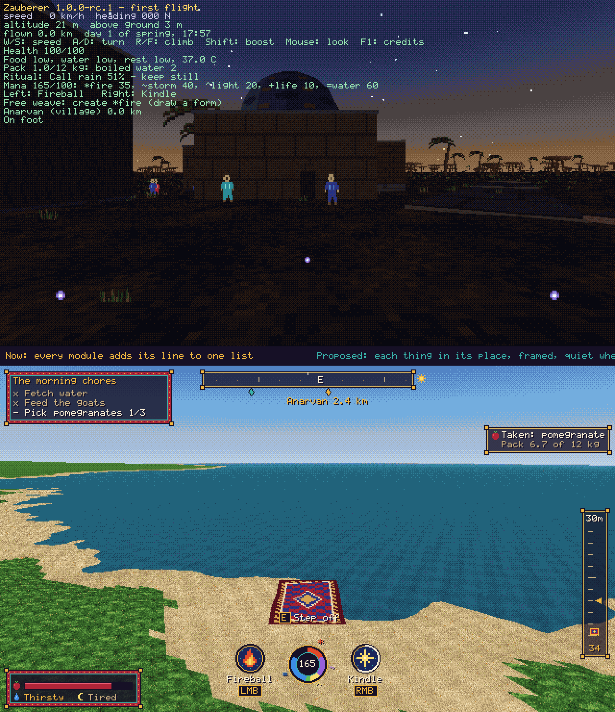
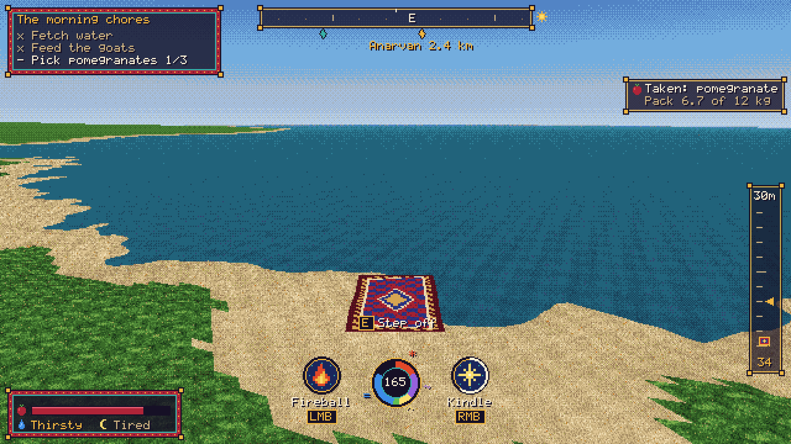
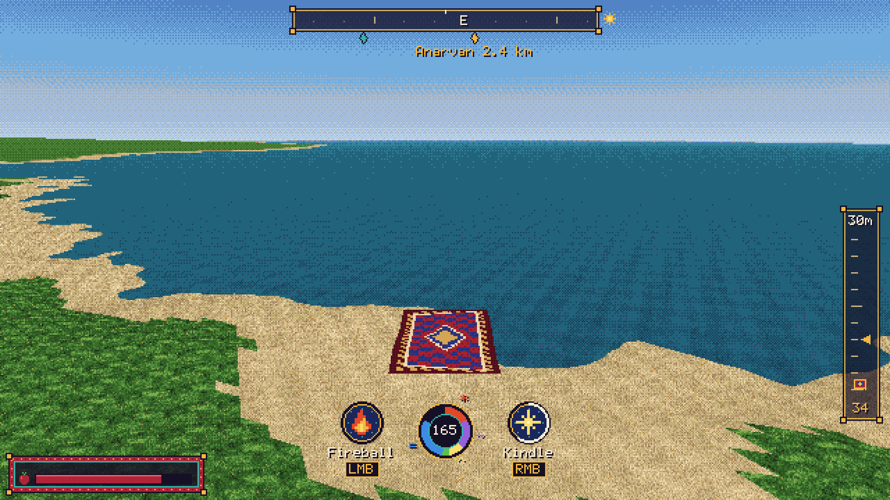
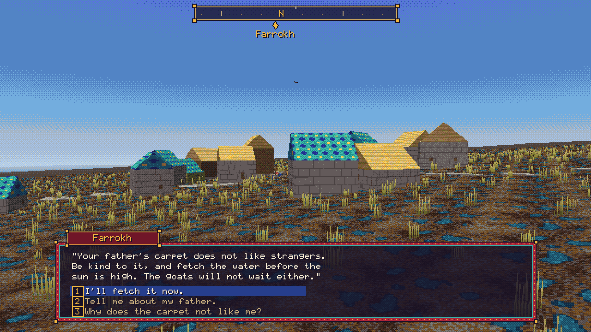
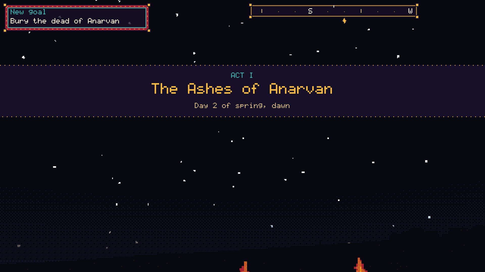
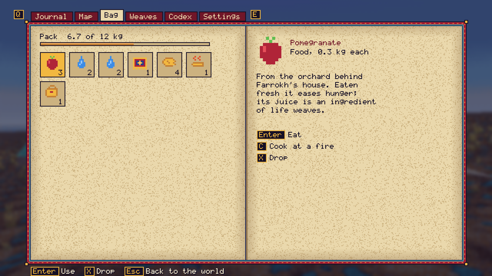
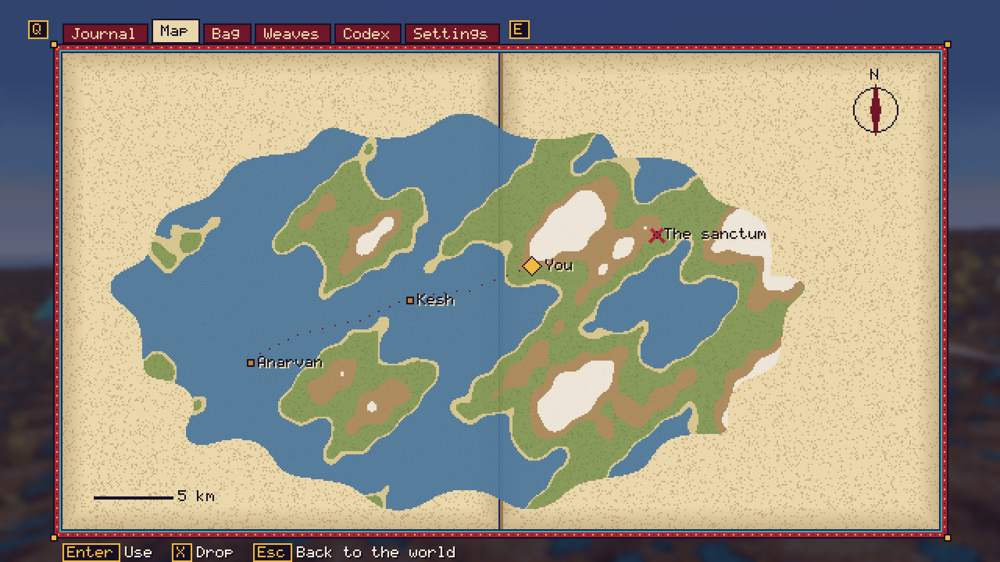
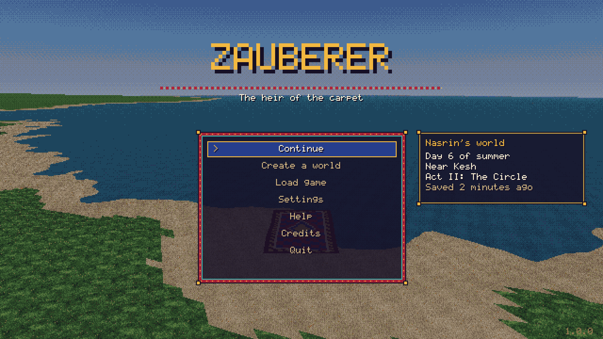

# A UI for Zauberer: proposal

Status: proposed (six OpenSpec changes, listed at the end). Mockups in this folder are
drawn on the game's 640×360 UI grid in its own pixel font, over real frames, by
`tools/design/ui_mockups.py`.

## What is wrong now

Every module adds its line to one list in the top-left corner: the version, speed and
heading, the control legend, health, food and water, the pack's contents, the ritual,
mana, the hands, the free weave, the place, "On foot", the story beat, the Circle's next
remnant, mods' lines. In play that is 15 to 30 lines of one colour, in one font size,
over the sky. Nothing has a place, nothing is more important than anything else, and the
numbers are raw ("Mana 7971/100", "37.0 C", "flown 0.0 km"). The menus are the same:
centred lists of words. The engine can only draw text (`render.draw_text`), so nothing
else was possible.

The concept (docs/concept/08, §8.1) asked for something else: "pixel fonts, hand-drawn
frames with carpet-border ornament, and diegetic elements where possible (spellbook, map
table, mana ring on the wrist)", and a mana reservoir shown as "a ring of colored
segments" (03, §3.2).

## Principles

1. **The world first.** The HUD keeps to the edges and corners. The middle of the screen
   and the sky are left to the world. Nothing covers the carpet.
2. **Show what matters now.** Few things are always there (the compass, the hands and
   mana, health). Everything else comes when it matters (a need that wants something, a
   prompt, a pickup, a story turn) and goes again. After a while of calm flight the HUD
   draws back to almost nothing.
3. **No free-floating text.** Every piece of text has a home: a panel, a plate, a chip,
   a card or a page. A line of text on its own over the world is a bug.
4. **One look, taken from the carpet.** Frames are kilim borders: an ink edge, a
   pomegranate band with saffron diamonds, a turquoise inner line, knotted corners. HUD
   panels are dark ink glass, the menus are parchment pages of the father's book, story
   moments are ink bands edged with saffron. The palette is the concept's: lapis,
   turquoise, saffron, pomegranate, ochre, parchment, ink.
5. **Icons and words, never colour alone.** Every mana colour keeps its glyph
   (`* ~ ^ + = # o %`), every need has an icon and a word, states have shapes.
6. **Ask with the device in hand.** Every prompt is a chip with the binding of the
   device last used (`E`, `[A]`, a touch button) and a verb ("Step off").
7. **Diegetic where it helps.** The menu is the father's book (Journal, Map, Bag,
   Weaves, Codex, Settings as tabbed pages), mana is a ring on the wrist between the two
   hands, the map is painted from the land the heir has seen.
8. **The mood follows the world.** Frames take the light of the hour (warm at dusk,
   lapis at night), danger warms the edges, pages turn with a sound, story cards unroll.
   Reduced motion turns the movement off.

## The flight HUD

| Zone | What lives there | When |
|---|---|---|
| Top middle | The woven compass band: headings, the goal (saffron diamond with name and distance), known places nearby (turquoise), the sun or moon in its knot | Always |
| Top left | The objective card: the current goal and its steps, ticked as they are done | When a goal is set; shrinks to its title in calm flight |
| Right, upper | Toasts: pickups, discoveries, "Game saved", sound captions with their direction. At most three, newest on top, each fading after a few seconds | On an event |
| Right edge | The carpet's gauge, a hanging tassel: height above the ground, speed, the carpet's condition as its fringe | In flight |
| Bottom middle | The two hands as illuminated medallions (the weave's icon, its name, the binding chip, a charge ring), the mana ring between them (a segment and glyph per colour, the total in the middle) | Always (dimmed in calm flight) |
| Above the hands | The contextual prompt: a chip and a verb ("E Step off", "F Talk to Farrokh") | When there is something to do |
| Bottom left | Health as a bar beside a pomegranate; under it the needs (thirst, hunger, tiredness, cold) as icon and word, only when they want something | Health always; needs on demand |

In calm flight (no input change, no event for 8 s) the HUD draws back to the compass,
the hands and health, at reduced strength:

### Where the current lines go

| Now (HUD line) | Proposed |
|---|---|
| "Zauberer 1.0.0-rc.1 - first flight" | Title screen and the book's corner only |
| speed, heading, altitude, above ground | Compass band (heading), the carpet's gauge (height, speed) |
| flown km, day/season/time | The book's Journal page; the sun/moon on the compass; the day on the chapter card |
| W/S speed A/D turn ... control legend | Help pages; contextual prompt chips; first-time hints as toasts |
| Health | Health bar, bottom left |
| Food, water, rest, temperature | Need icons that appear only when they want something; the body page in the book |
| Pack 6.7/12 kg: ... | A toast on change; the Bag page |
| Ritual: Call rain 51% - keep still | A ring round the cast point and a prompt chip "keep still" |
| Mana ... | The mana ring |
| Left: Fireball Right: Kindle | The hand medallions |
| Free weave: create *fire (draw a form) | The gesture trail and a prompt over the hands while drawing |
| Story: ..., the Circle's next remnant | The objective card and the compass's goal mark |
| Place (Anarvan, village, 0.0 km) | A place name card when it is entered; the compass's place marks |
| On foot / Low and slow: E to step off | The prompt chip |
| Captions ("[fire crackling, right]") | Toasts with an arrow for the direction |
| Mods' lines | A mod panel slot under the toasts, framed |

## Story and people

Speech is a framed box low on the screen with the speaker's plate; choices are numbered
rows with their chips. A turn of the story is a card across the middle (the act, its
name, the day) and the new goal arrives in the objective card:

## The book (the menu)

The menu becomes the father's book over the dimmed world: two parchment pages, tabs above
(Q and E, or the shoulder buttons, turn them), the bindings for the page below. Mouse
hover and click and touch work on every row, tab and slot.

The Map page is painted from the land the heir has seen (sea, shore, lowland, highland,
peaks), with the way flown, the places, the heir and the goal, a compass rose and a scale
(the terrain in this mockup is illustrative):

## The title

The title stands over the waiting world: the name in the carpet's colours, a woven band,
the choices in a framed panel, and beside them the save that Continue would load (whose
world, the day, where, the act, when it was saved).

## The changes

| Change | What it adds |
|---|---|
| `add-ui-drawing-layer` | The engine's 2D layer: rectangles, images and atlas cells, nine-slice frames, textures made from pixels, clipping, on the UI grid with integer scale; a Lua layout kit (anchors, safe areas, hit testing for mouse and touch) |
| `add-ui-art-kit` | `tools/gen/gen_ui.py`: the kilim frames, parchment, chips, the icon atlas (needs, items, weaves, mana glyphs, compass marks), the palette, high-contrast and colour-vision variants |
| `redesign-hud` | The zoned flight and walking HUD above, the calm HUD, toasts, the prompt chip, the mods' slot; the line list retired |
| `add-story-presentation` | Speech boxes with plates and choices, chapter cards, place name cards, the objective card |
| `redesign-menus-as-book` | The title over the world with the save's summary, the book with tabs (Journal, Map, Bag, Weaves, Codex, Settings), the painted map, mouse and touch on everything |
| `add-ui-mood-and-feedback` | Frames lit by the hour, danger at the edges, transitions and UI sounds, UI scale, reduced motion |
